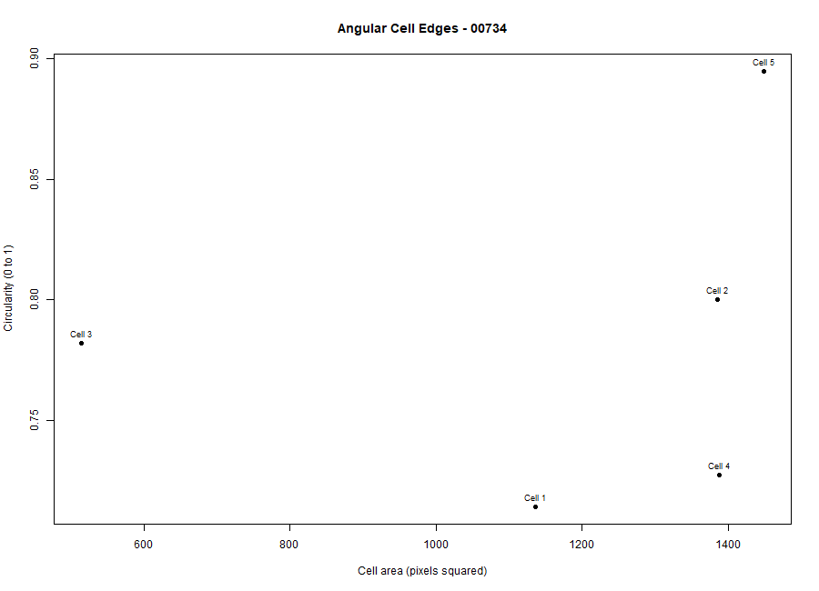
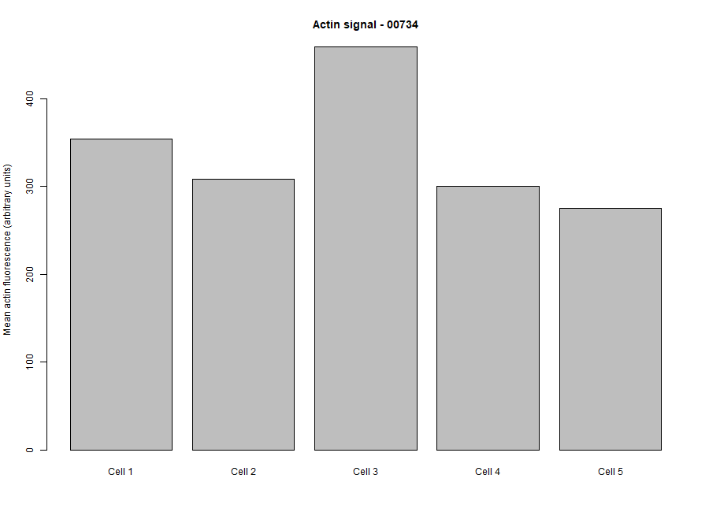

## Cytoskeleton and Cell Morphology Analysis

**Student ID:** 202400695
**Selected Phenotype:** Angular Cell Edges  
**Image Field ID:** 00734

## Objective

To examine cell morphology and actin fluorescence using the BBBC018 image dataset, measure five cells in Fiji, and analyze the measurements using R.

## Dataset

The dataset used was [BBBC018](https://bbbc.broadinstitute.org/BBBC018) from the Broad Bioimage Benchmark Collection.

**Image files used:**
- `00734-actin.DIB`
- `00734-DNA.DIB`

The selected phenotype was Angular Cell Edges, based on visual classification of the actin image.

## Methods

### Fiji Image Analysis
1. Opened the actin image in Fiji using Bio-Formats.
2. Set measurements for area, mean gray value, and shape descriptors.
3. Traced five cells using the Freehand Selection tool.
4. Added the selections to ROI Manager and measured the cells.
5. Saved the measurements as `data/fiji_results.csv`.

## R Analysis
The Fiji results were imported into R. The analysis calculated the mean cell area, circularity, aspect ratio, and actin signal. Two plots were generated to visualize the measurements.

## Results

Five cells were measured from image field 00734.

| Measurement | Mean Result |
|---|---:|
| Cell area | 1174.4 pixels² |
| Circularity | 0.7836 |
| Aspect ratio | 1.3032 |
| Mean actin signal | 339.463 |

## Figures

**Figure 1. Area vs. Circularity**

**Figure 2. Actin Intensity**

## Interpretation

The five measured cells had a mean circularity of 0.7836 and a mean aspect ratio of 1.3032. These values summarize the shapes of the selected cells. The mean actin signal was 339.463 arbitrary units. Since only five cells from one image field were measured, the results represent this sample and may not represent the entire dataset.

## Limitations

Only five cells from one image field were analyzed. Cell selection and tracing may affect the measurements. More cells and additional image fields would be needed for a broader comparison.

## Files

- `data/fiji_results.csv` — Fiji measurements
- `scripts/analyze_cells.R` — R analysis script
- `results/cell_summary.csv` — Summary statistics
- `figures/area_vs_circularity.png` — Area and circularity plot
- `figures/actin_intensity.png` — Actin intensity plot

## Dataset Credit

We used image set BBBC018v1 from the Broad Bioimage Benchmark Collection (Ljosa et al., Nature Methods, 2012).

Images are provided under the CC BY-NC-SA 3.0 license. Attribution should be retained when sharing images or screenshots.
